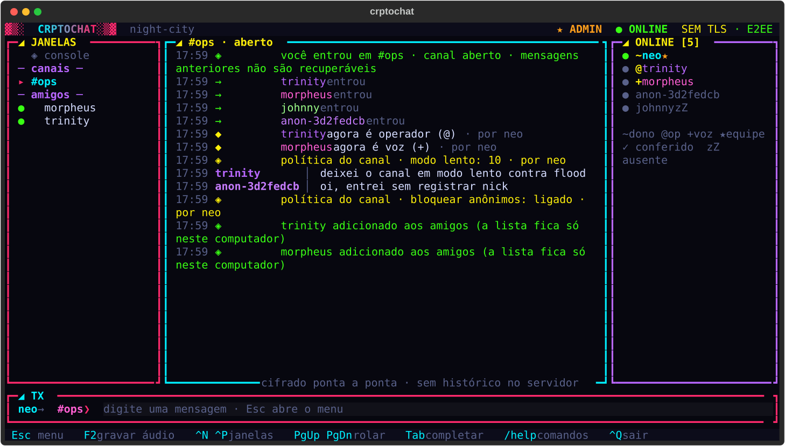

# ▓▒░ CRPTOCHAT ░▒▓

Chat para terminal Linux com **criptografia ponta a ponta**, servidor cego e
transferência de arquivos **P2P**. O servidor só encaminha blobs cifrados: não
consegue ler as conversas e, por padrão, não guarda histórico nenhum.



- **E2EE de verdade**: as chaves nascem e ficam nos clientes.
- **Sem histórico por padrão**: mensagens só existem na RAM de quem está online. Fechou, sumiu.
  Canais privados podem ligar um histórico cifrado com a senha do canal, com prazo (veja *Histórico de canais privados*).
- **Canais abertos e privados** (privados protegidos por senha que nunca vai ao servidor).
- **Nicknames permanentes**: cada nick fica preso a uma chave Ed25519 e nunca pode ser reutilizado por outra pessoa.
- **Mensagens de voz** cifradas ponta a ponta, em canais e diretas.
- **Arquivos** cifrados de ponta a ponta, repassados pelo servidor sem gravar nada (ou direto, P2P, com `--p2p`).
- **TUI cyberpunk**: janelas, contador de não lidas, menções, Tab-completion, histórico, mouse.

## Instalação

Para quem só quer usar: a página `site/downloads/index.html` é o anúncio público com os binários, a conferência
da assinatura (`RELEASE.sig`) e do SHA-256, e como conectar. Ela é estática e sem nada externo; antes de publicar,
troque `__PIN__` pela fingerprint do certificado do servidor (`docker logs crptochat`) e ponha na mesma pasta os
binários, o `RELEASE` e o `RELEASE.sig` da mesma release.

Requer Python 3.10+.

```bash
git clone https://github.com/hacking-table/crptochat-oss.git
cd crptochat-oss
python3 -m venv .venv && . .venv/bin/activate
pip install .
```

Isso instala quatro comandos: `crptochat` (cliente), `crptochat-server`,
`crptochat-dash` (painel do operador) e `crptochat-admin` (administração).

**Só o cliente, já compilado** (Linux e macOS): o site
`https://crptochat.acpt.app.br/downloads/` publica cada release, com um
`install.sh` que traz a chave pública de assinatura embutida. Não precisa de
conta no GitHub.

```bash
curl -fsSLO --proto '=https' https://crptochat.acpt.app.br/downloads/install.sh && sh install.sh
```

Antes de instalar, ele confere a assinatura Ed25519 do manifesto `RELEASE`
(`RELEASE.sig`) com a chave embutida e o SHA-256 do binário contra esse
manifesto assinado. Assinatura ausente, inválida, de outra chave, binário que
não confere ou que não está no manifesto: **nada é instalado**. Releases
publicadas sem `CLIENT_SIGNING_PUBKEY` não trazem `install.sh`.

- **Confira a chave.** O instalador mostra a fingerprint da chave que traz
  embutida (`chave de assinatura deste instalador: SHA256 …`). Ela tem de ser
  igual à publicada aqui:

  Fingerprint da chave de assinatura das releases:
  `SHA256 bbb1 c46e c211 64f5 2da8 8815 ebbe b73c 6795 0bea e86e 79b4 a781 8057 cd77 ce1e`

  (chave pública `oH5pJyULtqqayVJ0sOWdrSbSOj+NqlNGnNkPd05yOYE=`; confira com
  `python -m crptochat.update fingerprint`). O workflow de release recusa
  publicar se a `CLIENT_SIGNING_PUBKEY` não bater com essa fingerprint. O
  instalador mostra a fingerprint mesmo sem `openssl`, e, quando há como
  calcular, confere que ela é a da chave que ele traz.
- **Sem downgrade.** A data do build está no manifesto assinado. O
  instalador recusa uma release mais antiga que o binário instalado (lido
  com `crptochat --build-info`, 1.8+) ou que a última que ele mesmo instalou
  (guardada em `~/.local/state/crptochat/installed-build`), mesmo com
  assinatura válida. Para voltar de propósito: `sh install.sh
  --allow-downgrade` (ou `CRPTOCHAT_ALLOW_DOWNGRADE=1`).
- **macOS:** o `openssl` do sistema é LibreSSL, que não confere Ed25519. É
  preciso o OpenSSL 3 (`brew install openssl@3`; o instalador o encontra em
  `/opt/homebrew/opt/openssl@3` ou `/usr/local/opt/openssl@3` mesmo fora do
  `PATH`) ou o `python3` com a biblioteca `cryptography`
  (`python3 -m pip install --user cryptography`). Sem nenhum dos dois o
  instalador recusa em vez de instalar sem conferir. No Linux o OpenSSL 3 já
  vem nas distribuições atuais.

## Servidor

```bash
crptochat-server --port 7777 --data /var/lib/crptochat
```

Na primeira execução ele gera um certificado TLS autoassinado e imprime a
fingerprint SHA-256. Passe essa fingerprint aos usuários por outro meio.

| Opção | Descrição |
|---|---|
| `--host`, `--port` | endereço e porta de escuta (padrão `0.0.0.0:7777`) |
| `--data DIR` | onde ficam o registro de nicks/canais e o certificado |
| `--name`, `--motd` | nome e mensagem do dia |
| `--reg-token T` | exige um token para registrar novos nicks (ou env `CRPTOCHAT_REG_TOKEN`) |
| `--reg-limit N` | registros por IP por hora (padrão 5, `0` desliga) |
| `--cert`, `--key` | usa um certificado próprio |
| `--no-tls` | desliga o TLS (o conteúdo continua E2EE, mas metadados ficam visíveis na rede) |

Docker:

```bash
docker build -t crptochat-server .
docker run -d -p 7777:7777 -v crptochat:/data crptochat-server
```

### Painel do operador

Com o servidor rodando, quem o administra abre em outro terminal:

```bash
crptochat-dash --data /var/lib/crptochat
docker exec -it <container> python -m crptochat.dash --data /data   # no Docker
```

O painel atualiza a cada segundo e mostra **apenas contagens agregadas**:

- **Conexões**: sessões autenticadas, conexões TCP abertas, pico, total aceito, falhas de autenticação.
- **Tráfego cifrado**: mensagens de canal e envelopes diretos por segundo e no total, bytes de entrada/saída, bloqueios por taxa.
- **Canais e nicks**: quantos canais existem (abertos/privados), quantos têm gente agora, tamanho do maior, distribuição de ocupação, nicks registrados.
- **Recursos**: CPU e memória do processo, RAM e load do host, descritores, atraso do event loop, tamanho do registro em disco.

Nenhum nick, nome de canal, IP ou conteúdo aparece, e o snapshot que alimenta
o painel nem contém esses dados. "Envelopes diretos" inclui mensagens diretas,
troca de chaves e sinalização de arquivos: o servidor não sabe diferenciá-los.

O painel lê um socket Unix em `<data>/stats.sock` (modo 0600, só o usuário do
servidor acessa; nada é exposto na rede). `--once` imprime um quadro e sai,
`--json` devolve o snapshot bruto para scripts e monitoramento, e
`crptochat-server --no-stats` desliga o socket.

### Administração do servidor

O operador administra pelo console, no mesmo lugar do painel:

```bash
crptochat-admin --data /var/lib/crptochat                       # console interativo com menu
crptochat-admin --data /var/lib/crptochat role neo admin        # um comando e sai
docker exec -it crptochat python -m crptochat.admin --data /data   # no Docker
```

| Comando | Faz |
|---|---|
| `users [online\|staff\|banned] [texto]`, `user NICK` | lista e detalha usuários |
| `role NICK admin\|mod\|user` | cargos do servidor |
| `ban NICK [30m\|12h\|7d\|perm] [--ip] [motivo]`, `unban NICK`, `bans` | banimentos |
| `kick NICK` | desconecta agora |
| `channels`, `chan #CANAL` | canais, donos, políticas e bans |
| `chanrole #CANAL NICK owner\|op\|voice\|none`, `policy #CANAL NOME VALOR`, `chanunban` | intervém em qualquer canal |
| `guests on\|off`, `notice TEXTO` | acesso anônimo, aviso para todos online |
| `updaterepo [https://…\|github:dono/repo\|none]` | origem de atualização sugerida aos clientes (padrão: o site) |
| `ratelimit [show\|set NOME VALOR\|reset NOME\|all]` | limites anti-flood e quantas vezes dispararam |
| `health [watch]` | painel de saúde (abaixo); `watch` atualiza a cada 2 s |

**Painel de saúde** (`health`, ou a opção 1 do menu): online registrados e
anônimos, conexões e pico; canais (privados, com gente, com histórico e
quantas mensagens cifradas estão guardadas); bans ativos de nicks, de
endereços e em canais; quantas vezes os limites anti-flood dispararam nos
últimos 10 min, na última hora e desde o início (recusas, avisos, mutes,
expulsões, conexões recusadas); transferências de arquivo em andamento; e
as versões dos clientes conectados. São só contagens: nenhum nick, canal ou
endereço aparece. Clientes 1.8+ informam a versão no login (só o número;
qualquer outra coisa é descartada); os mais antigos aparecem como
"antiga (não informa)".

Admins valem como dono em qualquer canal e moderadores como operador. Pelo
próprio chat a equipe usa `/gkick`, `/gban nick 7d --ip motivo` e `/gunban`
(ou `Esc` → *Moderação do servidor*); só admins mexem em moderadores e
ninguém mexe em admins.

- **Banimento por endereço** (`--ip`): bloqueia também novas contas e sessões
  anônimas daquele endereço. O endereço é guardado só como hash com chave
  secreta do servidor, nunca em texto, e o console nunca o mostra.
- **Anônimos** só podem ser banidos por endereço (não têm conta). Bans de
  anônimos dentro de um canal ficam na memória até o servidor reiniciar.
- O console fala com o servidor por `<data>/admin.sock` (modo 0600), então só
  o usuário do servidor tem acesso. Ele mostra nicks, porque moderação
  precisa deles, mas continua sem acesso a nenhuma mensagem.

### Limites anti-flood

O servidor não lê as mensagens, então o controle de flood olha só para quem
envia, com que frequência e quanto. São baldes de fichas (*token bucket*) por
conexão, com valores menores para anônimos:

| Limite | Registrados | Anônimos |
|---|---|---|
| mensagens de canal | 3/s, rajada de 15 | 1/s, rajada de 5 (e 3/s somando todos os anônimos de um IP) |
| envelopes grandes (áudio) | 512 KiB/s, rajada de 3 MiB | 128 KiB/s, rajada de 1 MiB |
| envelopes diretos | 20/s, rajada de 400 | 5/s, rajada de 250 |
| entradas em canal | 20/min, rajada de 50 | 6/min, rajada de 10 |

Por endereço: 32 conexões simultâneas, 5 sessões anônimas e 5 nicks novos
por hora. Cada envelope cifrado tem no máximo 64 KiB.

Quem passa do limite tem a mensagem recusada e leva uma infração: na 1ª
recebe um aviso, na 3ª fica silenciado por 60 s nos canais e na 6ª dentro de
um minuto é desconectado, e o endereço fica bloqueado por 5 min
(`flood_ban_minutes`; 0 só desconecta). Continuar mandando enquanto
silenciado também conta.

Reconectar não zera nada: as infrações, o mute e o contador de mensagens do
endereço ficam guardados por 10 min (`ip_memory`) depois que a conexão fecha,
e uma conexão nova do mesmo endereço herda esse histórico, somado de todas as
sessões que passaram por ali. Atenção ao efeito combinado com a janela das
infrações (`strike_window`, 60 s): uma infração só conta para a escalada
enquanto tem menos de 60 s, então, na prática, os 10 min de memória preservam
o **mute em andamento** e o fato de o endereço **já ter sido avisado** (a
próxima infração não gera aviso de novo). A contagem que leva à desconexão só
sobrevive a uma reconexão rápida. Para que a memória pese mais, aumente
`strike_window`.

Um endereço banido é recusado já na conexão, antes de qualquer outra coisa,
então não consegue nem trocar mensagens antes do login. Bans automáticos (de
flood) só aumentam: se o endereço já tem um ban mais longo ou permanente, ele
fica como está, com o rótulo original. Quem é banido sem ter feito login
aparece em `bans` como `sem-login-xxxxxxxx` (`unban sem-login-xxxxxxxx`). A escalada em si é
por sessão, para que um flooder não silencie quem já está conectado atrás do
mesmo NAT; quem chegar depois desse endereço, porém, herda as infrações dele
enquanto a memória durar. O bloqueio por flood aparece em `bans` com o nick que
o causou, e `unban NICK` o remove.
Envelopes diretos não são silenciados, porque também levam as chaves dos
canais; eles só obedecem ao limite de taxa.

Tudo é ajustável com o servidor no ar e fica salvo:

```bash
crptochat-admin --data DIR ratelimit                        # valores, padrões e disparos
crptochat-admin --data DIR ratelimit set anon_msg_rate 0.5
crptochat-admin --data DIR ratelimit reset all
```

`--reg-limit N` na linha de comando do servidor sobrescreve só o limite de
nicks novos, e só até ele reiniciar.

**Os limites por endereço usam o IP real da conexão** (o `peername` do
socket TCP). Se o servidor ficar atrás de um proxy reverso, balanceador ou
túnel que não preserve o IP de origem, todos os clientes vão parecer vir do
mesmo endereço e dividir os mesmos limites. Nesse caso, aumente
`conns_per_ip`, `anon_per_ip`, `reg_per_hour` e `anon_ip_msg_*` (por exemplo,
`ratelimit set conns_per_ip 500`) ou zere os que não fizerem sentido; o
servidor hoje não lê `X-Forwarded-For` nem PROXY protocol. Do mesmo modo,
clientes atrás de CGNAT ou do mesmo escritório dividem um IP: se for o caso da
sua comunidade, suba `conns_per_ip` (padrão 32) pelo console.

O que fica em disco no servidor (`registry.db`): nick → chave pública, e
nome/tipo/salt/verificador dos canais. Nenhuma mensagem, nenhum arquivo, nenhum log de conversa.

## Cliente

```bash
crptochat chat.exemplo.com            # pergunta nick e senha
crptochat chat.exemplo.com:7777 -n neo -j '#lobby'
crptochat                             # reutiliza o último servidor e nick
```

No primeiro uso de um nick o cliente cria a chave de identidade, cifrada com a
sua senha, em `~/.config/crptochat/identities/<nick>.json`, e registra o nick
no servidor. **Faça backup desse arquivo**: quem perde a chave ou a senha perde
o nick para sempre (ninguém consegue registrá-lo de novo, nem o dono).

### Chave em pendrive

A chave do nick não precisa ficar no computador:

```bash
crptochat chat.exemplo.com -n neo --key-dir /media/voce/PENDRIVE   # cria/usa a chave no pendrive
crptochat -n neo --move-key /media/voce/PENDRIVE                   # move uma chave já existente
```

Dentro do chat, o mesmo está em `Esc` → *Mover minha chave*
(lista os dispositivos montados em `/media`, `/run/media` e `/mnt`).

Ao criar um nick novo o cliente também pergunta onde guardar a chave. A pasta
é lembrada por nick: nas próximas vezes basta conectar o pendrive e abrir o
`crptochat`. Se o dispositivo não estiver montado o cliente avisa e para, em
vez de criar outra chave. A chave é carregada na memória ao abrir, então o
pendrive pode ser removido logo depois (inclusive durante reconexões). O
arquivo continua cifrado com a sua senha; em quem achar o pendrive, ela é a
única barreira, então use uma senha forte e mantenha uma segunda cópia.

### Trocar a senha da chave

```bash
crptochat -n neo --change-pass     # fora do chat; não precisa de servidor
```

Dentro do chat: `/passwd` ou `Esc` → *Trocar a senha da minha chave*. Funciona
com a chave na pasta padrão, no pendrive (`--key-dir`) e nos cofres (inclusive
`--key-cmd`, desde que haja `--key-store-cmd` para gravar).

- **A chave não muda**: o nick, a fingerprint e as suas marcas ✓ continuam
  valendo, e os seus contatos não veem aviso nenhum. Só a cifra do arquivo muda
  (senha nova, salt novo).
- **A senha atual é conferida contra o que está guardado**, não contra a
  memória do chat; errada, nada muda.
- **Sem perder a chave no meio do caminho**: primeiro uma cópia completa e
  conferida (`<nick>.json.new`), depois o arquivo original é sobrescrito no
  lugar, com o mesmo tamanho, e a cópia é apagada. Se faltar energia no meio,
  o cliente abre pela cópia. Em SSD e pendrive a sobrescrita é melhor esforço.
- **O que não resolve**: cópias antigas do arquivo (backup, outro pendrive,
  histórico do `pass` com git) continuam abrindo com a senha antiga. Se alguém
  pode ter copiado o arquivo, trocar a senha não basta: a chave é a mesma, e
  hoje não há rotação de chave mantendo o nick.
- Se usa `--pass-cmd` ou `CRPTOCHAT_PASSPHRASE`, atualize a senha lá também.

### Chave em cofre de senhas

A chave do nick também pode morar num cofre de senhas em vez de um arquivo:

```bash
crptochat chat.exemplo.com -n neo --vault pass      # cria/usa a chave no cofre
crptochat -n neo --move-key vault:pass              # move uma chave já existente para o cofre
crptochat -n neo --move-key ~/.config/crptochat/identities   # traz de volta para arquivo
```

| `--vault` | Cofre | Comando usado |
|---|---|---|
| `pass` | password-store (GPG) | `pass` |
| `secret-tool` | Secret Service: GNOME Keyring, KWallet, KeePassXC | `secret-tool` |
| `vault` | HashiCorp Vault KV (caminho em `CRPTOCHAT_VAULT_PATH`, padrão `secret/crptochat/{nick}`) | `vault` |

Para qualquer outro cofre com linha de comando, informe o comando que imprime a
chave (e, se quiser gravar por ele, o que a recebe pela entrada padrão):

```bash
crptochat host -n neo --key-cmd 'bw get notes crptochat-{nick}'
crptochat host -n neo --key-cmd 'op read op://Private/crptochat-{nick}/notesPlain'
crptochat host -n neo --key-cmd 'keepassxc-cli show -a Notes ~/cofre.kdbx crptochat-{nick}'
```

Nesses casos o conteúdo guardado é o do arquivo `identities/<nick>.json`.

Como funciona:

- **Duas camadas**: o que vai para o cofre é a chave já cifrada pela senha da
  identidade. Quem abrir o cofre ainda precisa dessa senha, que continua sendo
  pedida ao abrir o chat.
- **Lembrado por nick**: depois da primeira vez basta abrir o `crptochat`. Se o
  cofre estiver bloqueado ou ausente o cliente para, em vez de criar outra chave.
- **Nunca sobrescreve**: criar ou mover para um cofre que já tem uma chave
  desse nick é recusado.
- **Mover é seguro**: a cópia é lida de volta e conferida antes de a original
  ser apagada; se não der para conferir, a original fica.
- **No chat**: `Esc` → *Mover minha chave* lista pendrives e os cofres instalados.

`--pass-cmd 'comando'` busca também a senha da identidade num cofre, sem
digitar. É cômodo, mas se a chave e a senha ficarem no mesmo cofre a segunda
camada deixa de existir.

Só a integração com `pass` é exercitada pelos testes automatizados (com `pass`
e GnuPG reais). `secret-tool` e HashiCorp Vault seguem a linha de comando
documentada de cada um, e os exemplos de Bitwarden, 1Password e KeePassXC
dependem do seu ambiente; confira com uma chave de teste antes de confiar.

Opções úteis: `--pin <fingerprint>` (confere o certificado do servidor já na
primeira conexão), `--reset-pin`, `--reg-token`, `--no-tls`, `--p2p-port`,
`--p2p-host`, `--downloads`. A senha pode vir da env `CRPTOCHAT_PASSPHRASE`.

### Menu interativo

Pressione `Esc` (ou `F1`, ou digite `/menu`) para abrir um menu com todas as
ações, sem precisar decorar comandos: entrar em canal a partir da lista, criar
canal aberto ou privado, mensagem direta, enviar arquivo, aceitar ou recusar
ofertas, ver e conferir fingerprints, **mover a chave do nick para um
pendrive**, ajuda, limpar e sair. Cada ação abre diálogos que pedem só o
necessário (escolha de nick/canal em lista, caminho do arquivo, senha).

### Comandos

Tudo o que o menu faz também existe como comando:


| Comando | O que faz |
|---|---|
| `/list` | lista os canais |
| `/create #canal` | cria um canal aberto |
| `/create #canal privado` | cria um canal privado (pede a senha em um diálogo) |
| `/join #canal` | entra em um canal (pede a senha se for privado) |
| `/leave` | sai do canal atual ou fecha a conversa direta |
| `/msg nick texto` | mensagem direta |
| `/query nick` | abre uma janela de conversa direta |
| `/mode #canal +t 1h\|-t`, `/ttl nick 10m\|off` | mensagens temporárias no canal e na conversa direta |
| `/mode #canal +h 7\|-h` | histórico cifrado por 7 dias num canal privado (desligado por padrão) |
| `/chanpass #canal` | troca a senha do canal privado e gira a chave (só o dono) |
| `/rec`, `/play [n]`, `/stop` | grava/envia mensagem de voz, ouve, interrompe |
| `/voice mascarada\|natural` | liga/desliga o disfarce de voz (padrão: ligado) |
| `/send nick\|#canal arquivo [--p2p]` | arquivo pelo servidor (padrão) ou direto, P2P |
| `/accept [id]`, `/reject [id]` | aceita ou recusa um arquivo |
| `/who`, `/whois nick`, `/fp` | fingerprints e número de segurança |
| `/passwd` | troca a senha que protege a sua chave (a chave e o nick continuam os mesmos) |
| `/verify nick` | confere a chave de alguém e marca ✓, ou aceita uma chave que mudou |
| `/unverify nick` | remove a marca ✓ |
| `/search texto` (ou `Ctrl+F`) | busca nas conversas abertas, só na memória local |
| `/notify on\|off`, `/notify preview on\|off` | notificações do sistema em menção e mensagem direta |
| `/clear`, `/quit` | limpa a tela, sai |

Teclas: `Esc` abre o menu, `F2` grava áudio, `Ctrl+N`/`Ctrl+P` trocam de janela (ou clique na lista), `PgUp`/`PgDn`
rolam, `Tab` completa comandos/nicks/canais, `↑`/`↓` histórico, `Ctrl+L` limpa,
`Ctrl+Q` sai. Segure `Shift` para selecionar texto com o mouse.

### Acesso anônimo

`crptochat host -a` (ou digitar `anon` no lugar do nick) entra sem registro e
sem senha. A chave é descartável e só existe na memória; o nick é derivado
dela (`anon-1a2b3c4d`), então ninguém consegue escolher o nick anônimo de
outra pessoa. Anônimos conversam normalmente, mas não criam canais nem têm
lista de amigos, e cada canal pode barrá-los. O operador do servidor desliga
o acesso anônimo com `crptochat-server --no-guests`.

### Cargos e moderação dos canais

Quem cria um canal é o dono. Os cargos seguem o estilo do IRC:

| Cargo | Marca | Pode |
|---|---|---|
| dono | `~` | tudo, inclusive dar e tirar operador e transferir o canal (`/owner nick`) |
| operador | `@` | expulsar (`/kick`), banir (`/ban`, `/unban`, `/bans`), dar voz, convidar, mudar políticas |
| voz | `+` | falar quando o canal está moderado |

Ninguém age sobre quem tem cargo igual ou maior. Os cargos ficam gravados e
valem nas próximas visitas. Expulsar ou banir alguém troca as chaves do
canal, então a pessoa não lê nada do que for dito depois. Tudo está também
em `Esc` → *Moderar um membro*.

### Políticas de canal

Só operadores e o dono mudam (`/policy nome valor` ou `Esc` → *Políticas do canal*):

| Política | Efeito |
|---|---|
| `noanon` | usuários anônimos não entram |
| `moderated` | só quem tem voz, operadores e o dono falam |
| `invite` | só entra quem foi convidado (`/invite nick`) ou tem cargo |
| `textonly` | bloqueia áudio e mensagens enormes |
| `slow N` | cada pessoa espera N segundos entre mensagens (antiflood) |
| `limit N` | máximo de pessoas no canal |
| `ttl` | mensagens temporárias (`/mode #canal +t 1h`) |
| `history N` | histórico cifrado por N dias, só em canal privado (`/mode #canal +h N`); 0 desliga |
| `history_anon` | anônimos também recebem o histórico ao entrar (padrão: não) |

O servidor aplica essas regras sem ler as mensagens: ele só olha quem envia,
com que frequência e o tamanho do envelope cifrado. Por isso não existe
filtro de palavras.

### Amigos, ausência e temas

- **Amigos**: `/friend add nick`, `/friend del nick`, `/friends`. Aparecem na
  barra lateral com `●` online, `◐` ausente, `○` offline, e você é avisado
  quando entram ou saem. A lista fica só no seu computador; o servidor não
  sabe quem são seus amigos.
- **Ausente**: `/away recado` e `/back`. Quem te mandar mensagem direta recebe
  o recado uma vez; o recado vai cifrado, o servidor só sabe que você está
  ausente. Nas listas você aparece com `zZ`.
- **Temas**: `/theme` lista, `/theme nome` aplica, e `Esc` → *Temas* pré-visualiza
  com as setas. Há `neon` (padrão), `synthwave`, `matrix`, `ambar`, `gelo`,
  `sangue`, `mono` e `papel` (claro). A escolha é lembrada.

### Notificações e busca

**Notificações do sistema** avisam quando alguém te menciona num canal ou
manda mensagem direta (texto ou voz), mas só quando você poderia perder:
a mensagem chegou em outra janela, ou o terminal está sem foco (em
terminais que informam o foco). Ligadas por padrão; `/notify off` desliga e
a escolha fica salva. Há no máximo uma notificação a cada 5 s por conversa.

- Linux/BSD: `notify-send` (pacote `libnotify-bin`); macOS: `osascript`;
  Windows: notificação nativa via PowerShell. Sem notificador instalado, nada
  acontece (`/notify` mostra o estado).
- **Por padrão a notificação não leva o texto**: só "mensagem direta de bob"
  ou "ana mencionou você em #ops". Tudo o que vai para o sistema sai da
  proteção do chat: pode aparecer na tela de bloqueio, ficar no histórico de
  notificações e ser sincronizado. `/notify preview on` inclui o texto, com
  aviso.
- O texto nunca passa por shell: vai como argumento (ou variável de ambiente
  no Windows), sem caracteres de controle, sequências de escape ou bidi. No
  `notify-send` o corpo é marcação, então `&`, `<` e `>` são escapados (nada
  de links ou imagens injetados). No Windows é usado só o
  `powershell.exe` de `System32` (caminho absoluto), nunca o que aparecer
  primeiro no `PATH`.

**Busca** (`/search texto`, `Ctrl+F` ou `Esc` → *Buscar nas conversas*) abre
uma janela que filtra enquanto você digita, sem diferenciar maiúsculas nem
acentos, em todas as janelas abertas (a atual primeiro, mais recentes
primeiro). `↓` vai aos resultados e `Enter` abre a janela na linha
encontrada, destacada com `▶`. A busca só olha o que está na memória deste
computador: nada vai ao servidor, mensagens temporárias vencidas já não
existem para ela, e o que sumiu ao fechar o chat não volta.

### Mensagens temporárias

- **Canal**: operadores ligam com `/mode #canal +t 1h` (ou `/policy ttl 1h`, ou
  `Esc` → *Políticas do canal*) e desligam com `/mode #canal -t`. Vale de 1 s
  a 30 dias, todos no canal são avisados e o tempo aparece no topo da janela
  (`⏱ mensagens somem em 1h`). `/mode #canal` mostra os modos ligados; os
  modos `+m`, `+i`, `+a` e `+x` são atalhos para canal moderado, só
  convidados, sem anônimos e só texto.
- **Conversa direta**: `/ttl nick 10m` (ou `/ttl nick off`). O tempo é
  combinado ponta a ponta, vale para os dois lados e fica salvo localmente; o
  servidor não sabe que a conversa é temporária.
- Cada mensagem leva o próprio tempo dentro do conteúdo cifrado, e quem recebe
  aplica o menor entre o que veio na mensagem e o que conhece do canal.
- Ao vencer, a mensagem some da tela e da memória do cliente, inclusive os
  áudios guardados para `/play`. As linhas temporárias levam a marca `⏱`.
- Fora do histórico de canais privados, o servidor não guarda mensagem
  nenhuma. Com histórico ligado, a cópia cifrada guardada vence no menor
  entre o TTL e o prazo do histórico, e é apagada de verdade do banco.

**O que o TTL não protege.** Ele é uma cortesia entre clientes honestos, não
uma garantia:

- **Não impede cópia.** Qualquer pessoa no canal ou na conversa pode tirar
  print, fotografar a tela, copiar e colar o texto ou gravar o áudio enquanto
  ele ainda está visível.
- **Não resiste a cliente adulterado.** Quem recebe a mensagem tem o texto
  decifrado na mão; um cliente modificado pode simplesmente ignorar o tempo e
  guardar tudo. O servidor não tem como obrigar nenhum cliente a apagar.
- **O cliente 1.0.0 ignora o TTL por completo**, assim como qualquer versão
  anterior a esta: ele não lê o tempo que vem dentro da mensagem, não conhece
  a política `ttl` do canal nem o `/ttl` das conversas diretas, e mantém as
  mensagens na tela até fechar. Num canal com gente usando versões antigas, o
  que elas recebem não some.

Use o TTL para não acumular conversa por descuido, não para esconder algo de
quem participa dela.

### Histórico de canais privados

**Desligado por padrão.** O dono ou um operador de um canal **privado** liga
com `/mode #canal +h 7` (ou `/policy history 7`): o servidor passa a guardar
as mensagens por até 7 dias, **cifradas**, e entrega as últimas a quem entra.
`/mode #canal -h` desliga e apaga na hora o que estava guardado. Canais
abertos não têm histórico (não há senha da qual tirar a chave).

- **A chave vem da senha do canal.** scrypt (N=2^15, r=8, p=1) com um salt
  aleatório por canal gera uma chave mestra; HKDF separa dela três chaves
  independentes: a de entrada no canal (o servidor só vê um verificador), a
  das mensagens ao vivo e a do histórico. A senha e as chaves nunca saem do
  cliente.
- **O servidor guarda só cifrado.** Cada mensagem enviada com o histórico
  ligado vai acompanhada de uma cópia cifrada com ChaCha20-Poly1305, presa ao
  canal e à "época" da senha. Dentro dela: nick, chave pública, horário, texto
  e uma **assinatura Ed25519** de quem escreveu. Quem lê confere a assinatura
  contra a chave já conhecida para aquele nick (ou a do registro, que fica
  fixada como num primeiro contato): linhas que não batem aparecem com `⚠`, e
  o servidor não consegue inventar nem alterar linhas (não tem a chave).
- **Sem reaproveitar linhas dos outros.** O servidor anota quem enviou cada
  cópia, e o cliente recusa a linha se o autor assinado for outro: um membro
  não consegue repostar como nova uma linha assinada por outra pessoa. Cada
  linha tem um id aleatório assinado, e duplicadas são descartadas. Uma linha
  assinada numa época (senha) anterior só é aceita se o servidor a marcou como
  re-cifrada pelo dono no `/chanpass`.
- **Ninguém some com o histórico dos outros**, nem com várias contas. O
  servidor não consegue conferir as cópias (não tem a chave), então divide
  por remetente:
  - guarda no máximo `history_per_sender` (200) linhas de cada um por canal;
  - ao passar de `history_keep_msgs`, quem perde a linha mais antiga é o
    remetente com mais linhas guardadas, não o canal como um todo;
  - ao entregar, as vagas vão em rodízio: a linha mais nova de cada
    remetente, depois a segunda de cada um, e assim por diante. Quem escreveu
    pouco sempre aparece, por mais contas que alguém use para lotar;
  - anônimos só gravam histórico se o canal ligou `history_anon` (o mesmo
    que os deixa ler), e **todos os anônimos juntos contam como um remetente
    só** nessas regras: identidades descartáveis, uma linha cada, não
    conseguem empurrar para fora quem tem conta. O preço: com
    `history_anon` ligado, **um anônimo que faz flood apaga as linhas dos
    outros anônimos**, porque todos dividem a mesma cota. Quem quer que as
    próprias mensagens fiquem no histórico de forma confiável deve
    registrar um nick;
  - baixar esses limites no console vale na próxima limpeza (a cada 30 s),
    feita de uma vez, fora do caminho das mensagens.
- **Sem repetir.** Linhas que você já viu ao vivo ou num histórico anterior
  não voltam a aparecer, nem depois de uma reconexão.
- **Mensagem grande demais** (mais de 12 KiB depois de cifrada, por exemplo
  textos longos com muitos acentos ou emoji) é entregue ao vivo, mas não entra
  no histórico; quem enviou é avisado na hora.
- **Prazo e apagamento de verdade.** Cada linha vence em N dias (no máximo
  `history_max_days`, padrão 30) ou antes, se o canal tiver TTL. Uma limpeza
  roda a cada 30 s e faz `DELETE` com `PRAGMA secure_delete = ON`, que
  sobrescreve as páginas do SQLite. Baixar N encurta o que já está guardado.
  O servidor guarda no máximo `history_keep_msgs` (1000) por canal e entrega as
  últimas `history_max_msgs` (100); esses limites e o `history_per_sender`
  ficam em `ratelimit set`.
- **Aviso visível.** Com o histórico ligado, o título do canal mostra
  `📜 HISTÓRICO LIGADO (N d)`, a linha de baixo diz que o servidor guarda o
  cifrado, e quem entra (ou está no canal quando ligam) recebe um aviso. As
  linhas do histórico aparecem separadas da conversa ao vivo, com data.
- **Anônimos** só recebem o histórico se o canal ligar `history_anon`.
- **Trocar a senha gira a chave** (`/chanpass #canal`, só o dono): salt novo,
  chaves novas e uma época nova. Por padrão o histórico antigo é **apagado** e
  fica ilegível para a senha nova. Se o dono escolher *re-cifrar*, o cliente
  dele baixa o histórico, abre com a chave antiga e cifra de novo com a nova,
  de propósito; as assinaturas originais continuam valendo. Todos os outros
  membros saem do canal e precisam entrar de novo com a senha nova.
- **Compatibilidade.** O servidor anuncia `history` no welcome; cliente novo
  com servidor antigo não manda cópia nenhuma. Cliente 1.5 ou anterior num
  canal com histórico não manda cópia (as mensagens dele não ficam
  guardadas) e não vê o histórico nem o aviso: o aviso só aparece em clientes
  1.6+.

**O que o histórico enfraquece** (por isso fica desligado por padrão):

- **Acaba a garantia de "fechou, sumiu"** nesse canal: o cifrado fica no disco
  do servidor pelo prazo escolhido, e backups do servidor podem guardar cópias
  que o `DELETE` não alcança.
- **Sem sigilo futuro para o histórico**: a chave é fixa enquanto a senha não
  muda. Quem souber a senha **depois** (vazou, foi compartilhada, um ex-membro
  que a anotou) lê tudo o que ainda estiver guardado, inclusive o que foi dito
  antes de ele chegar. Mensagens ao vivo não têm esse problema.
- **Senha fraca vira risco maior**: o servidor (ou quem roubar o banco) pode
  tentar adivinhar a senha offline e, acertando, ler o histórico inteiro. Use
  senha longa e aleatória.
- **Expulsar não basta**: a chave do histórico não muda com `/kick` ou `/ban`.
  Quem saiu e sabe a senha lê o que for guardado depois se conseguir o
  cifrado (por exemplo, com acesso ao servidor). Troque a senha com
  `/chanpass` depois de tirar alguém.
- **Metadados**: o servidor passa a guardar, pelo prazo, quando cada mensagem
  foi enviada e o tamanho aproximado. Nicks e textos ficam dentro do cifrado.
- **Prova de autoria**: as linhas são assinadas, então quem tem a senha pode
  mostrar a terceiros que você escreveu aquilo.

### Verificação de identidade

Cada nick é uma chave Ed25519, e o servidor só repassa essas chaves, então
quem garante que você fala com a pessoa certa é você:

- **Fingerprint**: 6 grupos de 5 dígitos (`/whois nick`, `/fp` para a sua),
  calculada com hash iterado como os *safety numbers* do Signal.
- **Número de segurança**: `/whois nick` mostra também 12 grupos que são
  iguais dos dois lados da conversa. Leia em voz alta numa ligação ou compare
  pessoalmente; se o servidor tiver trocado alguma chave, os números não batem.
- **`/verify nick`** abre a conferência e marca ✓ ao lado do nick no painel,
  nas DMs e nos amigos.
- **TOFU**: a primeira chave vista de cada nick fica guardada neste computador.
  Se ela mudar, aparece um alerta em destaque, o nick ganha ⚠ e as mensagens
  diretas ficam bloqueadas **nos dois sentidos** (nem o que você manda nem o
  que chega). A chave nova só é aceita com `/verify nick`, depois de você
  confirmar por outro meio; aceitar remove a marca ✓, que precisa ser feita
  de novo. O aviso sobrevive a reiniciar o chat.
- Anônimos usam chaves descartáveis e não têm o que conferir.
- Clientes publicados antes desta mudança mostram a fingerprint antiga em hexadecimal; o
  `/whois` e o `/fp` mostram as duas para comparar com quem ainda não atualizou.

### Atualizações

O binário avisa quando há versão nova ao conectar e instala com `/update` (ou
`Esc` → *Atualizar o crptochat*, ou `crptochat --update` fora do chat). Desde a
1.10.0 ele busca no **site público** `https://crptochat.acpt.app.br/downloads/`,
sem login nem token: confere a assinatura do manifesto, a versão e o SHA-256,
testa o binário novo e só então substitui o atual; basta abrir o chat de novo.
`/update check` só verifica e `/update off` desliga o aviso. Instalações pelo
código-fonte só recebem o aviso (atualize com `git pull` e `pip`).

> **Quem tem a 1.9.0 ou anterior:** essas versões ainda procuram no GitHub
> (repositório privado) e não acham a atualização. Instale a 1.10.0 **uma vez**
> pelo site (veja *Instalação*); daí em diante o `/update` puxa do site.

Segurança da atualização:

- **Primeiro a assinatura.** O cliente baixa `RELEASE` (manifesto com versão,
  commit, data do build e o SHA-256 de cada binário) e `RELEASE.sig`
  (Ed25519) e confere a assinatura com a chave pública embutida no binário
  **antes** de acreditar em qualquer coisa do manifesto. Sem assinatura, ou
  assinada por outra chave, nada acontece, venha de onde vier. Um binário sem
  chave embutida não se atualiza sozinho.
- **Só para a frente.** A versão tem de ser maior **e** o build mais recente
  que o do binário em uso, e os dois estão dentro do manifesto assinado. Uma
  release antiga, mesmo com assinatura válida, não serve para fazer alguém
  voltar a uma versão vulnerável (nem a mesma versão, republicada).
- **Binário conferido e troca atômica.** O binário da plataforma é conferido
  contra o SHA-256 do manifesto assinado, executado uma vez (`--version`) e só
  então troca de lugar com o atual, de uma vez (`rename`).
- **Só HTTPS, sem credenciais.** `http://` é recusado, inclusive em
  redirecionamentos. Nenhum token, cookie ou login é mandado ao site. Cada
  download tem limite de tamanho (64 KiB o manifesto, 1 KiB a assinatura,
  200 MiB o binário) e de tempo total.
- **Ninguém troca a origem por você.** `CRPTOCHAT_UPDATE_URL=https://…` muda a
  origem (para um espelho, por exemplo). `/update origem https://…` (ou
  `crptochat --update-repo https://…`) também, e fica salvo; `/update origem
  padrao` volta ao site. O operador do servidor pode **sugerir** uma origem no
  console (`updaterepo https://…`), mas cada pessoa confirma a troca. Também
  dá para usar `github:dono/repo` (release mais recente do GitHub, acesso
  anônimo, só para repositório público) ou `file:///pasta` (espelho local).

Para publicar (quem mantém o repositório):

```bash
python -m crptochat.update genkey
```

A chave pública vai na variável de repositório `CLIENT_SIGNING_PUBKEY`
(Settings → Variables) e é embutida nos binários; a privada vai no secret
`CLIENT_SIGNING_KEY` e só o passo que assina a release a recebe. Antes de
publicar, o workflow confere a assinatura com a chave pública, então um par
trocado falha no CI em vez de gerar releases que ninguém aceita.

O workflow `release-client` embute nos binários a origem de atualização
(`CLIENT_UPDATE_URL`, padrão `https://crptochat.acpt.app.br/downloads/`) e
publica a release em `CLIENT_RELEASE_REPO`. **O site precisa receber os mesmos
arquivos da release** (`RELEASE`, `RELEASE.sig`, `SHA256SUMS`, `install.sh` e
os binários), e cada release que deve chegar pelo `/update` precisa de uma
versão nova em `crptochat/__init__.py`.

### Mensagens de voz

`F2` (ou `/rec`, ou o menu) começa a gravar para a janela atual, canal ou
conversa direta. `Enter` com a linha vazia, `F2` ou `/rec` de novo enviam;
`Esc` cancela. Limite de 1min30 por áudio. Quem recebe vê uma linha
`▶ áudio 0:12 /play 3` e ouve com `/play 3` (ou `/play` para o mais recente,
`/stop` para interromper). Nada toca sozinho.

O áudio usa a mesma criptografia das mensagens: é fatiado em envelopes
cifrados ponta a ponta e passa pelo relay sem ser armazenado. Nos clientes
fica só na memória (os 40 mais recentes da sessão); para gravar e tocar ele
passa alguns segundos por um arquivo em tmpfs (`$XDG_RUNTIME_DIR`), que é
sobrescrito e apagado em seguida.

#### Anonimato do áudio

Voz é biometria, então o áudio recebe proteções que o texto não precisa:

- **Voz mascarada por padrão**: antes de sair da máquina, a gravação passa por
  um deslocamento de tom aleatório e é ressintetizada com tom robótico fixo (a
  fase de cada quadro FFT é zerada), o que descarta o tom e a entonação
  originais. Filtros de banda, redução de ruído e normalização de volume
  achatam as características do microfone e do ambiente.
- **Falha fechada**: se o processamento falhar ou o `ffmpeg` não existir, nada
  é enviado. A gravação original nunca sai da máquina e é apagada.
- **Sem metadados**: todo áudio é recodificado para um formato único (Opus
  mono 16 kHz) sem tags, data, nome de dispositivo ou versão de software.
- **Tamanho escondido**: cada áudio é completado com bytes aleatórios até um
  múltiplo de 4 envelopes de tamanho fixo. O relay vê que algo volumoso
  passou, mas não a duração real.
- **Sem exposição de IP entre usuários**: ao contrário dos arquivos P2P, o
  áudio trafega pelo relay; quem ouve não descobre o seu endereço.

`/voice natural` desliga o disfarce (a barra de gravação avisa `VOZ NATURAL`)
e `/voice mascarada` religa; a escolha é lembrada.

O que o disfarce **não** faz: não esconde o que é dito, nem vocabulário,
sotaque, ritmo de fala ou um som de fundo alto e característico. Ele impede
reconhecimento de ouvido e comparação simples de voz; não há garantia contra
análise forense dedicada. Para o que for realmente sensível, texto é mais seguro.

Gravação e reprodução usam o que a máquina tiver: `ffmpeg`/`ffplay`
(recomendado: Opus, ~2,5 KiB/s), ou `parecord`/`paplay`, `pw-record`/`pw-play`,
`arecord`/`aplay`, `mpv`. Sem ffmpeg só é possível enviar com `/voice natural`,
em WAV 8 kHz (qualidade de telefone). Para um dispositivo específico, defina o comando:

```bash
export CRPTOCHAT_REC_CMD='arecord -q -D hw:1 -f MU_LAW -r 8000 -c 1 -t wav {out}'
export CRPTOCHAT_PLAY_CMD='mpv --no-video {file}'
```

Só são aceitos contêineres Ogg e WAV (conferidos pelos bytes iniciais), mas
tocar um áudio entrega dados de terceiros ao decodificador da sua máquina:
ouça apenas áudios de quem você confia.

### Arquivos

`/send nick arquivo` ou `/send #canal arquivo` manda pelo servidor, que é o
padrão; `Esc` → *Enviar arquivo* faz o mesmo pelo menu.

- **Cifrado de ponta a ponta**: o arquivo é cifrado no seu computador em
  blocos de 64 KiB (ChaCha20-Poly1305) com uma chave de uso único. A chave, o
  nome e o SHA-256 vão na oferta, dentro do envelope cifrado: o servidor vê
  só blocos opacos e quantos são.
- **Nada antes do aceite**: quem recebe vê `/accept id` ou `/reject id`. Ao
  aceitar, escolhe a pasta onde salvar (padrão `~/Downloads/crptochat`). O
  servidor recusa qualquer bloco antes disso.
- **Nada em disco no servidor**: os blocos passam pela memória e seguem
  direto. Uma janela de confirmações limita quanto fica em trânsito (16
  blocos), então a memória do servidor não cresce com o tamanho do arquivo.
- **Conferido no destino**: tamanho e SHA-256 são checados antes de o arquivo
  aparecer com o nome final; se algo não bate, o `.part` é apagado.
- **Nome seguro**: o nome é limpo (sem pastas, `..`, caracteres de controle,
  nomes ocultos ou reservados) e nunca sobrescreve um arquivo existente
  (`nome.1.ext`).
- **Canais**: a oferta vai para cada membro, e cada um decide. Membros com
  cliente antigo (1.4 ou anterior) não recebem e você é avisado.
- **Mensagens temporárias**: num canal ou conversa com TTL, a oferta expira
  junto, e o arquivo recebido é **apagado do disco** quando o tempo acaba (o
  diálogo de aceite avisa antes).
- **Limites no console** (`ratelimit set NOME VALOR`): `file_max_mb`
  (tamanho por arquivo, padrão 50 MiB; 0 desliga o envio pelo servidor),
  `file_kbps` e `file_burst_kb` (banda por usuário registrado, 2 MiB/s e
  rajada de 8 MiB), `anon_file_kbps` e `anon_file_burst_kb` (anônimos,
  256 KiB/s e 1 MiB) e `file_concurrent` (transferências simultâneas, 4). O
  cliente se ajusta à banda anunciada pelo servidor.
- **Memória por conexão**: o que espera para ser enviado a cada conexão é
  limitado em bytes (`out_queue_kb`, padrão 16 MiB; mínimo 1 MiB). Quem
  confirma blocos sem ler o socket tem a transferência cortada na metade
  desse limite, e uma conexão que passa dele é fechada.

**P2P, só quando pedido:** `/send nick arquivo --p2p` abre uma conexão direta
entre as duas máquinas, como antes. É mais rápido numa rede local, mas **cada
lado vê o endereço IP do outro**; o chat pede confirmação mostrando isso. É
também o único jeito de mandar arquivo para quem usa cliente antigo.

## Modelo de segurança

| Primitiva | Uso |
|---|---|
| Ed25519 | identidade do nick; assina o login, a chave de sessão e cada mensagem de canal |
| X25519 | chave de sessão **nova a cada login**, descartada ao desconectar |
| ChaCha20-Poly1305 | cifra autenticada de mensagens e arquivos |
| HKDF-SHA256 / HMAC-SHA256 | derivação de chaves e ratchet |
| scrypt (N=2¹⁵) | senha da identidade local e senha dos canais privados |

Tudo vem da biblioteca [`cryptography`](https://cryptography.io); nenhuma cifra caseira.

- **Diretas e sinalização**: ratchet por direção sobre chaves X25519
  efêmeras, detalhado em *Sigilo das mensagens diretas* abaixo.
- **Canais**: cada membro tem uma cadeia própria (*sender key* com hash
  ratchet, uma chave por mensagem), entregue aos outros membros pelo envelope
  par a par. Quem entra depois recebe só o estado atual da cadeia e não lê o
  que foi dito antes; quando alguém sai, todos trocam de cadeia.
- **Canais privados**: a senha gera, via scrypt, um token de acesso (o
  servidor guarda só um hash dele) e uma chave separada que embrulha as chaves
  do canal. Mesmo que o servidor coloque um intruso no canal, ele não lê nada.
- **Nicks**: o servidor só aceita um nick existente se o login for assinado
  pela chave original. Os clientes fixam a chave de cada nick no primeiro
  contato (TOFU) e, se ela mudar, bloqueiam as mensagens diretas nos dois
  sentidos até o usuário aceitar a nova (veja *Verificação de identidade*).
- **Servidor**: TLS 1.3 com fingerprint fixada no primeiro acesso, como no SSH.

### Sigilo das mensagens diretas (forward secrecy)

Tudo o que vai direto de uma pessoa para outra (mensagens, áudio, as chaves
dos canais, sinalização de arquivos e o `/ttl`) usa este protocolo:

1. **Chave de sessão efêmera.** A cada login o cliente gera um par X25519
   novo e o **assina com a chave de identidade Ed25519** do nick. Quem recebe
   confere a assinatura com a chave fixada (TOFU / `/verify`), então o
   servidor não consegue colocar uma chave sua no meio. A parte privada fica
   só na memória e é descartada ao desconectar.
2. **Raiz.** Os dois lados calculam o X25519 entre as chaves de sessão e
   derivam, por HKDF-SHA256 ligado às duas identidades, uma chave raiz para
   aquele par de sessões.
3. **Ratchet por direção.** Da raiz saem duas cadeias, uma de A para B e
   outra de B para A. A cada envelope a cadeia avança por HMAC-SHA256
   (`mk = HMAC(ck, 0x01)`, `ck = HMAC(ck, 0x02)`): cada mensagem usa uma chave
   nova, e a anterior não pode ser recalculada a partir da atual.
4. **Envelope v2.** `0x02 | n | ChaCha20-Poly1305(mk_n, pad(conteúdo))`, com
   remetente, destinatário e `n` no AAD. Envelope adulterado, repetido ou
   antigo é recusado sem mexer na cadeia; um envelope perdido no caminho
   (recusado pelo servidor) é pulado.
5. **Negociação por contato.** O primeiro envelope para alguém vai no formato
   antigo (v1, a chave par a par direta) anunciando suporte ao v2; a partir da
   primeira resposta de um cliente novo, os dois passam ao v2. Com clientes
   1.0.0 e anteriores tudo continua em v1, como antes.

6. **Estado ligado à raiz.** O estado das cadeias (e se o contato fala v2)
   fica guardado pelo valor da raiz. Se o servidor apresentar outra chave de
   sessão do contato (por exemplo, uma antiga, que tem assinatura válida) e
   depois devolver a verdadeira, a mesma raiz volta e as cadeias continuam de
   onde estavam: uma chave de mensagem nunca é usada duas vezes. Quando o
   contato abre uma sessão nova (raiz nova), o suporte a v2 é reaprendido, e
   quem voltou com um cliente antigo recebe v1 de novo. Depois que o contato
   mandou um envelope v2 numa sessão, envelopes v1 dele nessa mesma sessão são
   recusados, porque v1 não tem proteção contra repetição.

O que isso garante:

- **Vazar a chave de identidade não abre DMs antigas**: ela só assina; as
  chaves que cifram vêm das chaves de sessão, descartadas ao desconectar.
- **Sigilo por login**: o tráfego de uma sessão que já terminou não pode ser
  decifrado depois, nem com acesso total ao computador.
- Cada mensagem usa uma chave própria, e repetição, reordenação e adulteração
  são recusadas.

O que **não** garante:

- **Dentro de uma sessão aberta não há sigilo para trás.** Enquanto a sessão
  dura, a chave privada de sessão e a raiz ficam na memória do cliente (elas
  são necessárias para falar com quem reconecta). Quem copiar essa memória
  recalcula as cadeias desde o início e lê **toda a sessão**, antes e depois
  da cópia, até alguém reconectar. Para fechar isso seria preciso o ratchet de
  Diffie-Hellman a cada troca de mensagens (o Double Ratchet completo do
  Signal), que não está implementado.
- O servidor pode reapresentar uma chave de sessão antiga (assinada) de um
  contato; as mensagens cifradas para ela simplesmente não chegam, mas não há
  reuso de chave nem leitura. Ele também pode, como sempre, deixar de
  entregar mensagens.
- Com clientes 1.0.0 e anteriores, tudo fica em v1: a mesma chave para todas
  as DMs da sessão e sem proteção contra repetição.

### O que o servidor ainda enxerga

Metadados: IPs, nicks online, quem está em qual canal, horário e tamanho
aproximado (arredondado para 64 bytes) das mensagens, nomes dos canais.

### Limites que vale conhecer

- **Canais abertos são abertos**: qualquer um que registre um nick, inclusive o
  operador do servidor, pode entrar e ler dali em diante (a entrada aparece
  para todos). Para sigilo, use canal privado.
- **Primeiro contato é TOFU**: compare o número de segurança por outro meio
  (`/whois`, `/verify`) para descartar um servidor que troque chaves já no
  primeiro encontro; depois disso, qualquer troca é detectada e bloqueada.
- **Senha de canal fraca pode ser quebrada offline** por quem controla o
  servidor, a partir do verificador. Use senha longa.
- Mensagens de canal são assinadas, então não há negação plausível entre membros.
- Sem entrega offline para conversas diretas: só recebe quem está conectado.
  Em canais privados com histórico ligado, quem entra depois vê as mensagens
  guardadas (veja *Histórico de canais privados* e o que isso enfraquece).
- O código não passou por auditoria independente.

## Desenvolvimento

```bash
pip install -e ".[dev]"
pytest
```

Os testes sobem um servidor real e clientes reais em localhost e cobrem: E2EE
em canais, canais privados (inclusive servidor malicioso), diretas, nick
permanente, troca de chave detectada, reconexão, P2P direto e reverso, TLS
pinning e a TUI completa em modo headless.

```
crptochat/
  crypto.py    primitivas e ratchet
  protocol.py  formato de fio (JSON por linha)
  server.py    relay cego + registro de nicks/canais
  stats.py     contadores agregados e socket local do painel
  dash.py      painel do operador (`crptochat-dash`, só stdlib)
  admin.py     console de administração (`crptochat-admin`, só stdlib)
  client.py    motor do cliente (rede, E2EE, canais)
  relayfile.py arquivos pelo servidor (cifrados, sem gravar no servidor)
  p2p.py       transferência de arquivos direta (--p2p)
  audio.py     gravação e reprodução de mensagens de voz
  store.py     identidade local e chaves fixadas
  vault.py     chave do nick em cofres de senha
  update.py    verificação e instalação de atualizações
  tui.py       interface Textual
  themes.py    temas de cores
  cli.py       comando `crptochat`
```

### Verificações de segurança

O workflow `.github/workflows/security.yml` roda a cada push e PR, e toda semana
(vulnerabilidades novas aparecem mesmo sem mudar o código):

| Verificação | O que olha | Falha quando |
|---|---|---|
| **Bandit** (SAST) | o código do pacote | qualquer achado; exceções revisadas ficam marcadas `# nosec <id>` com o motivo ao lado |
| **Semgrep** (SAST) | regras `p/python` e `p/secrets` | achado de severidade ERROR |
| **pip-audit** | as dependências instaladas pelo projeto | vulnerabilidade conhecida |
| **gitleaks** | todo o histórico do git | segredo encontrado (saída mascarada) |
| **Trivy** | a imagem Docker do servidor | CVE HIGH/CRITICAL com correção disponível |
| **Fuzzing** | `tests/test_fuzz.py` com 10x as rodadas da suíte normal | qualquer exceção inesperada |

O fuzzing também roda na suíte normal (`pytest`) e cobre os dois lados do
modelo de ameaça:

- **Clientes hostis contra o servidor:** frames com campos de tipo errado,
  valores enormes, negativos, NaN, unicode estranho e tentativas de injeção em
  todos os comandos; lixo direto no socket antes e depois do login (bytes
  aleatórios, JSON inválido, bomba de recursão, linha maior que o limite). O
  servidor recusa, não deixa sessão pela metade e segue atendendo os outros.
- **Servidor hostil contra o cliente:** frames forjados para todos os
  tratadores do cliente e limites absurdos no `welcome`; o cliente descarta e
  continua conectado.
- **TLS:** só TLS 1.3 é aceito.

Se um comando do servidor falhar de um jeito não previsto, a conexão de quem
mandou é encerrada com `erro interno`, o contador `internal_errors` sobe e o
log registra só o tipo do frame e da exceção, nunca o conteúdo.


## Self-host com docker compose

Para rodar o seu próprio servidor:

```bash
git clone https://github.com/hacking-table/crptochat-oss.git
cd crptochat-oss
docker compose up -d --build
docker logs crptochat          # mostra a fingerprint do certificado (o --pin dos clientes)
```

O servidor escuta em TLS na porta `7777` e guarda os dados no volume
`crptochat-data`. Libere a porta 7777 só para quem deve conectar (firewall
do host ou da nuvem).

Antes de trocar o servidor em execução, vale rodar o autoteste na imagem nova
e, depois de subir, conferir o serviço no ar:

```bash
docker run --rm --entrypoint python crptochat-server -m crptochat.selftest
docker exec crptochat python -m crptochat.selftest --probe 127.0.0.1:7777 --stats /data
```

Os clientes conectam com `crptochat SEU_HOST --pin FINGERPRINT`.

Licença MIT.
